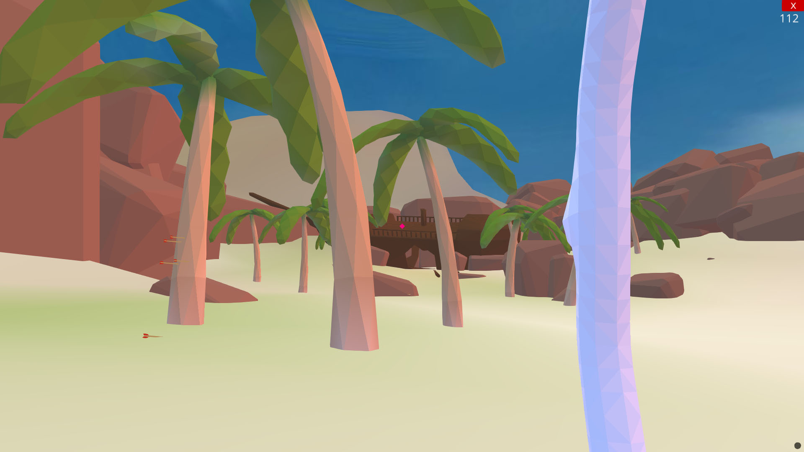

# Castaway (PyWeek 30)

A 3D first-person island exploration and puzzle adventure game built in Python using the **Ursina Engine** (Panda3D) for PyWeek 30.



## 🏝️ Overview

You find yourself stranded on a mysterious island. Explore the 3D tropical island, discover hidden chests, find tools like the bow and arrow, solve environmental puzzles, trigger ancient island gates, and find your way forward.

## 🕹️ Controls

- **W, A, S, D**: Move player
- **Mouse**: Look around
- **Space**: Jump
- **Shift (Hold)**: Sprint
- **Left Mouse Button (Hold & Release)**: Aim and shoot arrow (when bow is held)
- **E**: Interact / Open chests / Pick up items
- **Ctrl + R**: Reset player position (if caught on geometry)
- **Escape / Q**: Unlock mouse / Pause

## 🚀 Getting Started

### Prerequisites

- Python 3.8+ installed on your system.

### Installation

1. Clone the repository:
   ```bash
   git clone https://github.com/ShivamKR12/pyweek_30_castaway.git
   cd pyweek_30_castaway
   ```

2. Install dependencies:
   ```bash
   pip install -r requirements.txt
   ```

3. Run the game:
   ```bash
   python main.py
   ```

### Optional Preview Tools

- Run `python scene_preview.py` to inspect the 3D Blender scene assets and collisions interactively.

## 🛠️ Tech Stack & Credits

- **Game Engine**: [Ursina Engine](https://www.ursinaengine.org/) (powered by [Panda3D](https://www.panda3d.org/))
- **3D Modeling & Assets**: Blender (custom low-poly `.blend` scenes)
- **Shaders**: Ursina Colored Lights Shader & SSAO Shader
- **Original Author**: Created by [pokepetter](https://github.com/pokepetter) for PyWeek 30 ("Castaway").
